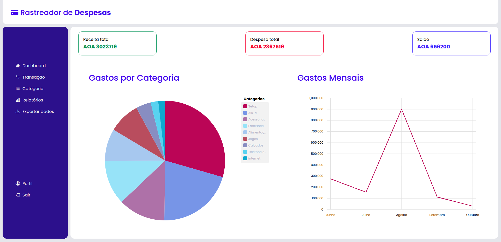

# Gerenciador de Gastos Pessoal (Expense Tracker)

Aplicação web fullstack para gerenciamento de finanças pessoais. Permite registrar entradas e saídas, categorizar gastos, visualizar saldos e acompanhar tendências por meio de gráficos interativos.

**Objetivo**: Oferecer uma ferramenta simples, intuitiva e escalável para controle de gastos diários, voltada especialmente para estudantes e profissionais que desejam melhorar a gestão financeira pessoal.

### Funcionalidades
* Registro de usuário (nome, email e senha)
* Login com retorno de JWT
* Logout (remoção do token no frontend)
* Rotas protegidas (middleware de autenticação JWT no backend)

### Transações
* Criar, listar, editar e excluir transações
* Campos: descrição, valor, tipo (entrada/saída), data e categoria
* Listagem ordenada por data (mais recente primeiro)
* Filtros por período, tipo, categoria

### Categorias
* Integração com o formulário de transações para criação de categoria
* Editar e excluir categorias sem nenhuma transação associada

### Relatórios e Visualizações
* Cálculo de saldo total (entradas − saídas)
* Cards de resumo (total de entradas, total de saídas e saldo)
* Resumo dos gastos e entradas, identificando o número de transações em cada categoria e o total gasto ou entrado.

### Tecnologias Usadas

* #### Frontend
  * Angular 18+
  * Ngx-Charts / Chart.js - Para gráficos no frontend
  * Bootstrap
* #### Backend e banco de dados
  * Node.js + Express.js
  * MongoDB + Mongoose
* Git

### Dashboard

### Formulário de Nova Transação

